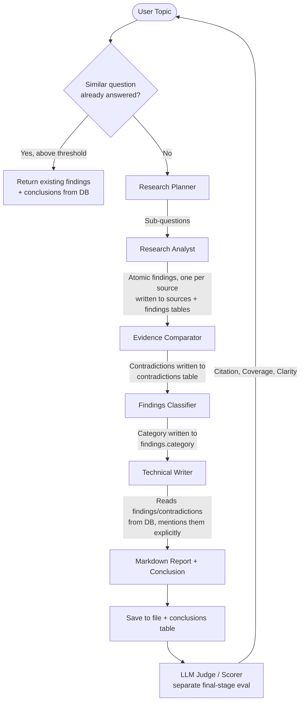

# NeuroSearch: Enterprise Multi-Agent Research & Evaluation Pipeline

NeuroSearch is an autonomous, multi-agent research pipeline powered by **CrewAI** and pluggable Large Language Models (local **Gemma** via **Ollama** by default, with optional **Ollama Cloud** and **Groq** backends). A team of specialized AI agents plans, researches, cross-checks, classifies, and writes comprehensive, well-cited reports on any topic — and every finding, source, contradiction, and conclusion is persisted to a structured SQLite database so the whole reasoning chain stays traceable and reusable.

This project features three distinct interfaces:
1. 🖥️ **Live surveillance Web UI** (Flask-based dashboard with real-time agent output streaming via Server-Sent Events)
2. ⚡ **Headless REST API** (FastAPI backend with streaming, traceability, and knowledge-search endpoints)
3. ⌨️ **Command-Line Interface** (CLI script for terminal operation)

---

## 🏗️ Architecture & Workflow

Before running full research, an incoming topic is embedded and compared against past `research_questions` in ChromaDB (knowledge reuse). If nothing close enough exists, the pipeline runs end-to-end, writing every stage's output to the database as it goes — not just at the end:



### 👥 The Research Team

| Agent | Role | Focus / Goal | Tools Used |
| :--- | :--- | :--- | :--- |
| **Research Planner** | `Research Planner` | Decompose topic into 4–6 specific, focused sub-questions. | None (analytical reasoning) |
| **Research Analyst** | `Research Analyst` | Extract atomic, single-claim findings — each tied to exactly one source — for every sub-question. | Web Search (Serper or DuckDuckGo), Wikipedia |
| **Evidence Comparator** | `Evidence Comparator` | Cross-check findings answering the same sub-question, flag genuine disagreements. | None (reads findings from DB) |
| **Findings Classifier** | `Findings Classifier` | Tag every finding with a category (adoption, technology, risk, regulatory, case-study, other). | None (reads findings from DB) |
| **Technical Writer** | `Technical Writer` | Synthesize *only* from findings/conclusions in the DB; explicitly calls out contradictions rather than silently resolving them. | None (reads findings/contradictions from DB) |

> The original single **Quality Critic** step has been split into the Evidence Comparator and Classifier above, which now run *before* the Writer instead of editing the report *after* it. `agents/critic.py` / `tasks/critique_task.py` remain in the codebase but are no longer part of the default pipeline. The LLM-as-judge evaluation in `eval/scorer.py` (citation/coverage/clarity) is a separate, final-stage quality check — it does not merge with the two stages above.

---

## 📁 Project Structure

```
research-pipeline/
├── agents/                    # Agent definition scripts
│   ├── base.py                 # Thin wrapper around llm/provider.py's get_llm()
│   ├── planner.py               # Research Planner agent
│   ├── researcher.py            # Research Analyst agent (with web/wiki tools)
│   ├── evidence_comparator.py   # Evidence Comparator agent (contradiction detection)
│   ├── classifier.py            # Findings Classifier agent
│   ├── writer.py                # Technical Writer agent
│   └── critic.py                # Legacy — kept, no longer wired into the pipeline
├── tasks/                     # Tasks assigned to agents
│   ├── schemas.py               # Pydantic output schemas (structured LLM outputs)
│   ├── plan_task.py             # Formulating research objectives
│   ├── research_task.py         # Extracting atomic findings + citations
│   ├── compare_task.py          # Cross-checking findings for contradictions
│   ├── classify_task.py         # Tagging findings by category
│   ├── write_task.py            # Writing the markdown report from DB findings
│   └── critique_task.py         # Legacy — kept, no longer wired into the pipeline
├── db/                         # Structured persistence / traceability layer
│   ├── models.py                # SQLAlchemy models (see schema below)
│   ├── session.py                # Engine/session factory, init_db()
│   └── repository.py             # All reads/writes — returns plain dicts
├── llm/                        # LLM provider abstraction
│   └── provider.py               # LLMProvider interface + get_llm() factory
├── tools/                      # Tools utilized by agents
│   ├── search_tool.py            # SearchProvider-backed CrewAI tool, with fallback
│   ├── providers/                 # SearchProvider interface + implementations
│   │   ├── base.py                  # SearchProvider ABC
│   │   ├── serper_provider.py       # Google results via Serper.dev (needs a key)
│   │   └── duckduckgo_provider.py   # Free, no-key fallback
│   ├── wiki_tool.py               # Wikipedia search wrapper
│   └── file_tool.py               # Helper to write reports to disk
├── memory/                     # ChromaDB-backed vector memory
│   ├── vector_store.py            # Generic persistent embedding collection
│   └── reuse.py                   # Knowledge reuse check + /knowledge/search index
├── worker/                     # Async job scaffolding
│   └── job_manager.py             # In-process ThreadPoolExecutor job runner
├── eval/                       # LLM-as-a-judge evaluation suite (final-stage, separate)
│   └── scorer.py                  # Automated scoring for citation, coverage, clarity
├── config/                     # Settings and parameters
│   ├── settings.py                # App settings & dotenv loader
│   └── agents_config.yaml         # Agent roles/goals/backstories + per-agent LLM overrides
├── templates/ / static/        # Flask Web UI assets
├── outputs/                    # Finished research reports (markdown)
├── research.db                 # SQLite traceability DB (gitignored, created on first run)
├── chroma_db/                  # ChromaDB vector store (gitignored)
├── app.py                      # FastAPI REST API
├── flask_app.py                # Flask Web UI server
├── main.py                     # Command-line interface
├── requirements.txt            # Dependency declarations
├── .env.example                # Documented template for all environment variables
└── .env                        # Local environment settings (gitignored)
```

---

## ⚙️ Setup & Installation

### 1. Prerequisites
- **Python 3.10** or higher.
- **Ollama** installed and running locally — this is the zero-cost default; no cloud API key is required to run NeuroSearch end-to-end.

### 2. Configure Local LLM
```bash
ollama pull gemma3:12b
```

### 3. Clone & Install Dependencies
```bash
python -m venv venv
# Windows:
.\venv\Scripts\activate
# Linux/macOS:
source venv/bin/activate

pip install -r requirements.txt
```

### 4. Configure Environment Variables
Copy the template and edit as needed:
```bash
cp .env.example .env
```
The defaults run everything locally with **no API keys**. See [LLM Providers](#-llm-providers) and [Search Provider & Fallback](#-search-provider--fallback) below for the opt-in cloud options.

---

## 🚀 How to Run

### A. Terminal Interface (CLI)
```bash
python main.py "The impact of AI on drug discovery in 2024" --eval
```
- `--eval` scores the final report after generation.
- `--force` skips the knowledge-reuse check and always runs fresh research, even if a near-duplicate question already exists in the DB.

### B. Interactive Web UI (Flask)
```bash
python flask_app.py
```
Open **`http://127.0.0.1:5000`**, type a topic, and watch the live agent trace stream in.

### C. FastAPI Backend REST API
```bash
uvicorn app:app --reload --port 8000
```
Interactive docs at **`http://127.0.0.1:8000/docs`**.

| Endpoint | Description |
| :--- | :--- |
| `POST /research` | Run the full pipeline, writing every stage to the DB. Returns the report plus `question_id`, `reused`, `findings_count`, `contradictions_count`. |
| `POST /research/stream` | Same pipeline, streamed as SSE. |
| `POST /research/async` | Returns `{job_id}` immediately; pipeline runs in a background thread. |
| `GET /jobs/{job_id}` | Poll status/result of an async job (`pending` / `running` / `done` / `failed`). |
| `GET /questions/{id}/trace` | Full traceability chain: conclusion(s) → the findings each was derived from → their sources. |
| `GET /questions/{id}/contradictions` | All contradictions flagged for a question. |
| `GET /knowledge/search?q=` | Semantic search over every past finding/conclusion. |
| `POST /eval` | Score an existing report without re-running the pipeline. |

All request bodies accept `{"topic": "...", "evaluate": false, "force_rerun": false}`.

---

## 🗄️ Traceability & Persistence Layer

Every research run is stored in a SQLite database (`db/models.py`, default `research.db`) with five tables that form a complete evidence chain:

```
research_questions (id, topic, sub_questions[json], created_at)
        │
        ├─▶ sources (id, question_id, url, title, retrieved_at, raw_content)
        │         │
        │         └─▶ findings (id, source_id, question_id, sub_question, text, category, created_at)
        │                   │
        │                   ├─▶ contradictions (id, finding_a_id, finding_b_id, explanation)
        │                   │
        │                   └─▶ conclusions (id, question_id, text, finding_ids[json], created_at)
```

- Every **finding** stores the `source_id` it came from — you can always answer "where did this claim come from?"
- Every **conclusion** stores the `finding_ids` it was derived from — you can always answer "what evidence backs this conclusion?"
- **Contradictions** link two findings with an explanation, so disagreements between sources are recorded rather than silently dropped.

Query the chain via the API:
```bash
curl http://127.0.0.1:8000/questions/1/trace
curl http://127.0.0.1:8000/questions/1/contradictions
curl "http://127.0.0.1:8000/knowledge/search?q=AI%20drug%20discovery%20risk"
```

### Knowledge reuse
Before running full research, the topic is embedded and compared (cosine similarity, ChromaDB) against every past `research_questions.topic`. If the best match is at or above `KNOWLEDGE_REUSE_THRESHOLD` (default `0.87`, configurable in `.env`), the existing findings/conclusions/contradictions are returned instead of re-running the pipeline — `reused: true` in the response. Pass `force_rerun: true` (API) or `--force` (CLI) to bypass this and always research fresh.

---

## 🔌 LLM Providers

Every agent gets its LLM from a single factory (`llm/provider.py`), selected via `LLM_PROVIDER` in `.env`. **Local Ollama is the default and requires no API key.** Cloud providers are strictly opt-in.

| `LLM_PROVIDER` | Cost | Where to get a key | Notes |
| :--- | :--- | :--- | :--- |
| `ollama_local` (default) | Free | — | Runs entirely on your machine via `OLLAMA_BASE_URL` (default `localhost:11434`). No rate limits beyond your hardware. |
| `ollama_cloud` | Free/paid tiers | `ollama signin` at [ollama.com](https://ollama.com) | Same Ollama API, hosted — set `OLLAMA_API_KEY`. Useful when local hardware can't run the model. |
| `groq` | Free tier, then paid | [console.groq.com/keys](https://console.groq.com/keys) | Fast hosted inference (e.g. `llama-3.3-70b-versatile`). Free tier has request-per-minute limits — see Groq's console for current limits. |

Per-agent overrides live in `config/agents_config.yaml` (e.g. a fast Groq model for the Planner/Classifier, a larger model for the Writer):
```yaml
planner:
  llm_provider: groq
  llm_model: llama-3.1-8b-instant
```
Any agent without an override falls back to the global `LLM_PROVIDER` / `LLM_MODEL` in `.env`.

**If a provider becomes unavailable** (auth error, timeout, rate limit), the pipeline does **not** silently return an empty report: the failing stage raises a `PipelineStageError` naming the stage and the underlying error, the API returns `502` with that detail, and the CLI/Flask paths surface the same message. There is no automatic cross-provider fallback for the LLM (unlike search, below) — switch `LLM_PROVIDER` in `.env` or fix the credentials and re-run.

---

## 🔍 Search Provider & Fallback

The Research Analyst's web search is abstracted behind a `SearchProvider` interface (`tools/providers/`), selected via `SEARCH_PROVIDER`:

- `serper` — Google results via [serper.dev](https://serper.dev) (free tier, requires `SERPER_API_KEY`).
- `duckduckgo` — free, no API key, via the `ddgs` package.
- `auto` (default) — uses Serper if `SERPER_API_KEY` is set, otherwise DuckDuckGo. This keeps a fresh clone fully runnable with zero keys.

If the configured provider's request fails at runtime (network error, rate limit, bad key), `tools/search_tool.py` logs the failure and automatically retries the query against DuckDuckGo before giving up — so a transient Serper outage degrades search quality rather than failing the whole pipeline.

---

## 📈 Scaling from ~10 to 100,000 Questions

The current setup (`worker/job_manager.py` + SQLite) is deliberately minimal so the project stays free and locally runnable. To scale:

1. **Queue-based workers.** `POST /research/async` already returns a `job_id` and runs the pipeline off the request thread via a `ThreadPoolExecutor`. Swap `job_manager.submit()` for a Celery `task.delay()` call backed by Redis or RabbitMQ, and run `celery -A worker worker` processes that can scale horizontally. Job status would move from the in-memory dict to a Redis hash or a `jobs` DB table so it survives restarts and is visible across processes.
2. **Postgres migration.** `DATABASE_URL` is the only thing that needs to change (`db/session.py` reads it directly) — point it at `postgresql+psycopg2://...` for concurrent writers, connection pooling, and indexing at volume. The SQLAlchemy models are dialect-agnostic.
3. **Caching via knowledge reuse.** The ChromaDB similarity check in `memory/reuse.py` already acts as a cache — as the corpus of past questions grows, an increasing fraction of new questions can be answered from `research_questions`/`findings`/`conclusions` without invoking any LLM or search call at all. At high volume this is the single biggest cost lever.
4. **Read scaling.** The `/questions/{id}/trace`, `/contradictions`, and `/knowledge/search` endpoints are pure reads — put them behind a cache (Redis) or read replica once `research_questions` grows past what a single Postgres instance comfortably serves.

---

## 📊 Evaluation Metrics
After generating a report, the scoring module (`eval/scorer.py`) uses an isolated judge model instance (its own optional `evaluator` override in `agents_config.yaml`) to grade the report on three indices:

1. **Citation Score (40% Weight)**: Verifies if claims are backed by source references and links.
2. **Coverage Score (35% Weight)**: Evaluates depth, breadth, and how comprehensively sub-questions were answered.
3. **Clarity Score (25% Weight)**: Examines spelling, layout structure, logic, and readability.

The scores are aggregated into a weighted average total score out of 10.0, along with direct feedback from the judge model. This step is intentionally separate from the Evidence Comparator/Classifier stages — it grades the finished report, not the intermediate findings. A judge response that fails to parse never falls back to a silent `0.0` — `EvalResult.parse_failed` is set instead and `total` is `None`, so a parse failure can't be mistaken for the judge's worst possible score.

---

## 🧪 Golden-Set Eval Harness

[](https://github.com/SpandanNagale/Crewai-Research-pipeline/actions/workflows/eval.yml)

`eval/golden/golden_set.json` is 28 fixed cases spanning four categories — no hand-authored "gold answer" text is stored for the research categories; groundedness, citation precision, and sub-question coverage are computed from each run's own instrumentation (`eval/metrics.py`), not graded against a pre-written reference:

| Category | Count | What it checks |
| :--- | ---: | :--- |
| `easy` | 8 | Well-documented topics — the pipeline's baseline behavior. |
| `ambiguous` | 6 | Genuinely contested questions with no single correct answer. |
| `low_resource` | 3 | Niche topics where search results are sparse — exercises degraded/unresolved handling. |
| `adversarial` | 8 | One per input-guardrail rule (too short/long, gibberish, injection, role-override, system-prompt extraction, code-gen, PII). Verified against the real guardrail: every entry trips its intended rule with zero false positives on the benign entries. |
| `contradiction_fixture` | 3 | Two deliberately conflicting findings seeded directly into the DB — asserts the Evidence Comparator flags them. |

Run it yourself against a running instance:

```bash
uvicorn app:app --port 8000 &
python -m eval.harness --base-url http://127.0.0.1:8000
```

This writes `eval/results.json` and `eval/results.md`. Only the `adversarial` and `contradiction_fixture` categories are pass/fail and gate the exit code (1 on any failure) — `easy`/`ambiguous`/`low_resource` are statistical (mean groundedness, citation precision, sub-question coverage, cache hit rate, fallback rate, cost per run, p50/p95 stage latency) and are **reported, not gated**, since there is no verified historical baseline yet to regress against; gating on a threshold with no real prior data would just be a fabricated number.

**CI** (`.github/workflows/eval.yml`) runs the harness on every push to `main` — there's no deployed instance yet (a later phase), so the workflow starts the FastAPI app inside the runner itself. `config/agents_config.yaml`'s per-agent provider list is built eagerly in full (`llm/router.py::get_deployments`), so all four cloud provider keys must be set as repo secrets — `OLLAMA_API_KEY`, `GROQ_API_KEY`, `OPENROUTER_API_KEY`, `GEMINI_API_KEY` — for the run to happen at all; `SEARCH_PROVIDER` is pinned to the free, keyless DuckDuckGo backend so a fifth key isn't required. If those secrets aren't configured, the job skips the live run with a warning rather than failing the build.

### Statistics

`eval/stats.py` provides bootstrap confidence intervals, paired bootstrap (for comparing two runs), Spearman rank correlation, and quadratic-weighted Cohen's kappa — the same methods [SpandanNagale/Assay](https://github.com/SpandanNagale/Assay)'s `lib/stats` uses for its own eval harness. Assay itself is a TypeScript/Next.js web app, not a Python package, so there's nothing to `pip install`; this ports the specific formulas rather than inventing different statistics from scratch.

### Judge calibration — pending

"An uncalibrated LLM judge is a vibe with a decimal point." `eval/calibrate.py` measures how well the judge (`eval/scorer.py`) agrees with a human rater on the same reports, via weighted Cohen's kappa and Spearman correlation. **No number is reported here yet** — that requires real hand-labeling, which this tool can't fabricate on your behalf:

```bash
python -m eval.calibrate label --reports-dir outputs   # blind 1-5 scoring, resumable
python -m eval.calibrate score  --labels eval/calibration_labels.json
```

Once you've run both against ~30 of your own saved reports, drop the resulting kappa/correlation numbers in here.

---

## 🔭 Langfuse Tracing

Opt-in, off by default. Set `LANGFUSE_PUBLIC_KEY` / `LANGFUSE_SECRET_KEY` (and optionally `LANGFUSE_HOST`, default `https://cloud.langfuse.com`; self-hosting works too) and every run gets one Langfuse trace, keyed on `run_id`:

- One span per pipeline stage, nested under the run's trace.
- One generation per `llm_attempt` — model, resolved deployment, tokens, cost, latency, attempt number, cache status.
- Guardrail firings recorded as `guardrail`-typed observations; cache hits as plain events.
- The pipeline's own real-time `groundedness_score` is attached to the trace as a score the moment the run finishes; the eval harness (above) separately attaches `citation_precision` for research-category golden-set runs, since that metric is only known after the fact from the harness's own trace lookup.
- `POST /research`, `POST /research/{run_id}/resume`, and the `done` event of `POST /research/stream` all carry a `trace_url` field — the UI renders it as a **"view trace"** link on the report modal.

`observability/langfuse_sink.py::trace_id_for(run_id)` derives the Langfuse trace ID deterministically from `run_id` via `Langfuse.create_trace_id(seed=...)` (a pure SHA-256 hash, no client or network call needed) — so the API process (building the trace URL) and the eval harness (a separate process, scoring a run against a *deployed* instance) always agree on the same trace, without sharing any in-memory state. Unset keys mean `EventBus` never even constructs a `LangfuseSink` (falls back to the existing no-op trace sink) and `trace_url` is always `None` — nothing else about the pipeline changes.

Live-verified against a real Langfuse (`us.cloud.langfuse.com`) project: a synthetic multi-stage event sequence and a real guardrail-blocked pipeline run both ingested correctly — trace name, nested spans, the generation's model/usage/cost fields, the guardrail observation, the cache-hit event, and the attached groundedness score were all confirmed via the Langfuse query API after ingestion. That live check caught a real bug the unit tests (fake client) couldn't: nesting children via `trace_context={"trace_id": ...}` on every call (not just the trace's root) marks *every* observation `AS_ROOT`, which made the trace's own name/input flicker to whichever child the backend happened to process last. Fixed by nesting children through real OTel context propagation (`opentelemetry.trace.use_span(parent._otel_span, ...)`) instead — only the genuine root uses the `trace_context` path now. Also covered by unit tests (`tests/test_langfuse_sink.py`) against a fake client for the exact span nesting, generation fields, and score payloads on every commit, without needing a live account.

---

## ✅ Testing

```bash
pytest tests/ -q
```

Test count has grown alongside the production-upgrade phases (each phase's own commits/plan under `docs/superpowers/`):

| Phase | Feature | Tests passing |
| :--- | :--- | ---: |
| 1 | LLM gateway (RouterLLM, provider fallback) | 24 |
| 2 | Observability spine (event bus, stage-dispatch, resume) | 64 |
| 3 | Real SSE streaming | 66 |
| 4 | Guardrails + groundedness critic stage | 90 |
| 5 | Caching (search, sub-question semantic, LLM response) | 99 |
| 6 | Golden-set eval harness, stats primitives, judge calibration, defect #8 fix | 141 |
| 7 | Langfuse tracing (trace/span/generation mapping, trace URL, eval score attach) | 170 |

---

## 🛠️ Customization
To adjust agent personalities, goals, or LLM backends:
1. Open [`config/agents_config.yaml`](./config/agents_config.yaml).
2. Modify the `role`, `goal`, or `backstory` parameters, or add `llm_provider` / `llm_model` / `llm_temperature` to override that agent's LLM.
3. Restart your server/script.
