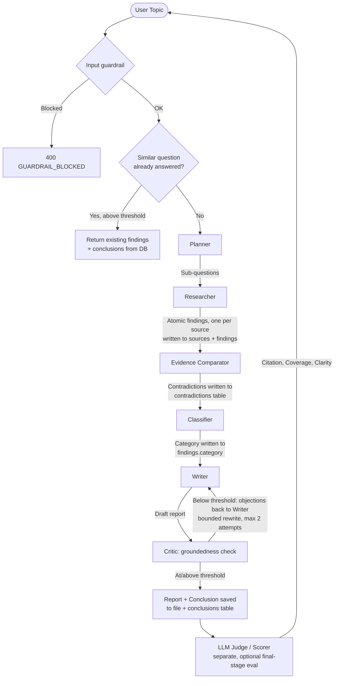

# Research Pipeline

A multi-agent research pipeline built on **CrewAI** and pluggable Large Language Models (local **Ollama** by default — zero cost, no API key — with optional **Ollama Cloud**, **Groq**, **OpenRouter**, and **Gemini** backends). Six specialized agents plan, research, cross-check, classify, write, and critique a report on any topic; every finding, source, contradiction, conclusion, and pipeline-run event is persisted so the whole reasoning chain is traceable, resumable, and reusable.

Three interfaces over one backend:

1. 🖥️ **Web dashboard** (Next.js, `frontend/`) — three panes: run configuration, the live pipeline via real-time SSE, and the finished report with inline claims/sources.
2. ⚡ **REST API** (FastAPI, `app.py`) — streaming, traceability, knowledge-search, and health endpoints.
3. ⌨️ **CLI** (`main.py`) — one-shot terminal runs.

---

## 🏗️ Architecture & Workflow

An incoming topic first passes the **input guardrail** (length, gibberish, prompt-injection, role-override, code-generation, and PII checks — all heuristic, no LLM call). It's then embedded (Gemini) and compared against past `research_questions` in the vector store (Postgres+pgvector in deployment, an in-process NumPy backend for local dev — see [Knowledge reuse](#knowledge-reuse)); a close-enough match short-circuits the whole pipeline and returns the existing findings/conclusions. Otherwise the six-stage pipeline runs, persisting every stage's output to the DB as it goes — not just at the end — and streaming a `RunEvent` for each meaningful thing that happens (`observability/`) so a client can watch it live.



### 👥 The Research Team

| Agent | Stage | Job | Tools |
| :--- | :--- | :--- | :--- |
| **Planner** | `planner` | Decompose the topic into 4–6 focused sub-questions. | None (reasoning only) |
| **Researcher** | `researcher` | Answer each sub-question with atomic, single-claim findings, each tied to exactly one source. | Web search (Serper/DuckDuckGo), Wikipedia |
| **Evidence Comparator** | `evidence_comparator` | Cross-check findings answering the same sub-question; flag genuine disagreements. | None (reads findings from DB) |
| **Classifier** | `classifier` | Tag every finding with a category (adoption, technology, risk, regulatory, case-study, other). | None (reads findings from DB) |
| **Writer** | `writer` | Synthesize *only* from findings/conclusions in the DB; explicitly calls out contradictions rather than resolving them silently. | None (reads findings/contradictions from DB) |
| **Critic** | `critic` | Score every claim in the draft against the DB findings; if the overall score is below threshold, hand specific objections back to the Writer for a bounded rewrite (max 2 attempts) before accepting a `degraded` result. | None (reads findings from DB) |

The LLM-as-judge in `eval/scorer.py` (citation/coverage/clarity, out of 10) is a **separate, optional, final-stage** quality check — pass `evaluate: true` (API) or `--eval` (CLI) to run it. It uses its own `evaluator` alias in `config/agents_config.yaml`, not one of the six pipeline stages above, and never merges with the Critic's groundedness gate.

---

## 📁 Project Structure

```text
research-pipeline/
├── agents/                    # CrewAI Agent factories, one per pipeline stage
│   ├── base.py                  # Thin wrapper around llm/provider.py's get_llm()
│   ├── planner.py, researcher.py, evidence_comparator.py,
│   │   classifier.py, writer.py, critic.py
├── tasks/                     # crewai Task definitions + structured output schemas
│   ├── schemas.py               # Pydantic output schemas
│   ├── plan_task.py, research_task.py, compare_task.py,
│   │   classify_task.py, write_task.py, groundedness_task.py
├── crew/
│   └── research_crew.py         # ResearchCrew: stage-dispatch loop, resume, reuse, caching glue
├── db/                         # Structured persistence / traceability layer
│   ├── models.py                 # SQLAlchemy models (12 tables — see Traceability below)
│   ├── session.py                # Engine/session factory, init_db() (no-op when VECTOR_BACKEND=pgvector)
│   └── repository.py             # All reads/writes — returns plain dicts, never ORM objects
├── alembic/                    # Schema migrations (owns Postgres schema in deployment)
│   ├── env.py                     # Wired to config.settings.settings.DATABASE_URL + db.models.Base.metadata
│   └── versions/                  # 0001 initial schema, 0002 enable pgvector extension, 0003 vector_documents
├── llm/                        # LLM provider abstraction + fallback routing
│   ├── provider.py                # LLMProvider classes (ollama_local/cloud, groq, openrouter, gemini) + get_llm()
│   ├── router.py                  # Builds each agent's ordered deployment chain from agents_config.yaml
│   ├── router_llm.py              # RouterLLM: tries each deployment in order, emits llm_attempt events
│   ├── response_cache.py          # Exact-match cache for deterministic stages (classifier, evidence_comparator)
│   └── byok.py                    # Thread-local bring-your-own-key override
├── guardrails/
│   ├── input_guardrail.py         # Pre-pipeline topic validation (length/gibberish/injection/PII/code-gen)
│   └── tool_output_guardrail.py   # Redacts instruction-shaped text in scraped/searched content
├── observability/               # Event bus, node states, error taxonomy, budget, tracing
│   ├── bus.py, context.py, events.py, node_state.py, errors.py, pricing.py
│   ├── budget.py                  # Daily spend tracking + kill-switch
│   └── langfuse_sink.py           # Optional Langfuse trace/span/generation export
├── tools/                      # Tools available to agents
│   ├── search_tool.py             # SearchProvider-backed tool, with cache + fallback
│   ├── providers/                  # SearchProvider interface + implementations (serper, duckduckgo)
│   ├── wiki_tool.py                # Wikipedia search wrapper
│   └── file_tool.py                # Report-to-disk helper
├── memory/                     # Backend-agnostic vector memory (see Knowledge reuse)
│   ├── vector_backend.py          # VectorBackend interface + InMemoryBackend/PgVectorBackend
│   ├── embedder.py                 # Gemini batch embedder, graceful degradation on failure
│   ├── vector_store.py            # ResearchMemory: thin per-collection wrapper over a VectorBackend
│   └── reuse.py                   # Whole-topic + per-sub-question knowledge reuse checks
├── worker/
│   └── job_manager.py             # ThreadPoolExecutor async job runner, status in the `jobs` table
├── eval/                       # Golden-set harness, statistics, judge + judge calibration
│   ├── scorer.py, golden/golden_set.json, harness.py, metrics.py, stats.py, calibrate.py
│   └── calibrate_reuse.py         # Empirical KNOWLEDGE_REUSE_THRESHOLD calibration against real embeddings
├── config/
│   ├── settings.py                # Typed settings, dotenv loader
│   └── agents_config.yaml         # Agent role/goal/backstory + per-agent model_groups fallback chains
├── frontend/                    # Next.js web dashboard — see frontend/README.md
│   ├── app/, components/, lib/
│   └── Dockerfile
├── tests/                       # pytest suite (221 tests — see Testing below)
├── docs/superpowers/             # Design specs and implementation plans from each build phase
├── outputs/                     # Finished research reports (markdown)
├── research.db                  # SQLite traceability DB, local dev only (gitignored, created on first run)
├── app.py                       # FastAPI REST API (API-only; the UI lives in frontend/)
├── main.py                      # Command-line interface
├── alembic.ini
├── Dockerfile, docker-compose.yml, .dockerignore
├── requirements.txt, requirements-dev.txt
├── .env.example                 # Documented template for every environment variable
└── .env                         # Local environment settings (gitignored)
```

---

## ⚙️ Setup & Installation

### 1. Prerequisites

- **Python 3.10+**.
- **Ollama** installed and running locally — the zero-cost default; no cloud API key is required to run the pipeline end-to-end.
- **Node.js 20+** if you want the web dashboard (`frontend/`); the CLI and REST API need only Python.
- **Docker** (optional) if you want `docker compose up` instead of running both services natively — brings up a real Postgres+pgvector container too, matching production. Without Docker, the default `.env.example` settings (`VECTOR_BACKEND=memory`, SQLite) need no database server at all. See [Deployment](#-deployment).
- A **`GEMINI_API_KEY`** is required even for the zero-cost local path — it's the only embedding provider wired up (`memory/embedder.py`), used for knowledge reuse and semantic search regardless of which LLM provider answers a given agent.

### 2. Configure Local LLM

```bash
ollama pull gemma3:12b
```

### 3. Clone & Install Dependencies

```bash
python -m venv venv

# Windows:

.\venv\Scripts\activate

# Linux/macOS:

source venv/bin/activate

pip install -r requirements.txt
```

### 4. Configure Environment Variables

```bash
cp .env.example .env
```

The defaults run everything locally with **no API keys**. See [LLM Providers](#-llm-providers), [Search Provider & Fallback](#-search-provider--fallback), and [Deployment](#-deployment) for the opt-in cloud options and hardening knobs.

---

## 🚀 How to Run

### A. Terminal Interface (CLI)

```bash
python main.py "The impact of AI on drug discovery in 2024" --eval
```

- `--eval` scores the final report after generation.
- `--force` skips the knowledge-reuse check and always runs fresh research, even if a near-duplicate question already exists in the DB.

### B. Web Dashboard (Next.js)

```bash
uvicorn app:app --reload --port 8000          # backend, in one terminal
cd frontend && npm install && npm run dev     # frontend, in another
```

Open **`http://localhost:3000`**. See `frontend/README.md` for details, including the one-click failure demo (fires the input guardrail live, no LLM calls). If the frontend runs on a different origin, set `CORS_ALLOWED_ORIGINS` on the backend (see `.env.example`) to match.

### C. FastAPI Backend REST API

```bash
uvicorn app:app --reload --port 8000
```

Interactive docs at **`http://127.0.0.1:8000/docs`**. This is API-only — no HTML is served here; use the dashboard above or call the endpoints directly.

| Endpoint | Description |
| :--- | :--- |
| `GET /health` | Liveness check. |
| `GET /health/providers` | Live status per (agent, provider) deployment — the dashboard's status dots. |
| `GET /health/budget` | Today's real spend vs. `DAILY_BUDGET_USD`, and whether the kill-switch is tripped. |
| `POST /research` | Run the full pipeline, writing every stage to the DB. Returns the report plus `question_id`, `run_id`, `reused`, `findings_count`, `contradictions_count`, `groundedness_score`, `trace_url`. |
| `POST /research/stream` | Same pipeline, streamed live as SSE (`stage_update` / `error` / `done` events). |
| `POST /research/async` | Returns `{job_id}` immediately; pipeline runs in a background thread. |
| `GET /jobs/{job_id}` | Poll status/result of an async job (`pending` / `running` / `done` / `failed`) — durable across a restart. |
| `GET /research/{run_id}` | Node-state view of one run (every stage's state/attempts) for polling without SSE. |
| `POST /research/{run_id}/resume` | Re-enters a failed/aborted run at its first non-succeeded stage. |
| `GET /questions/{id}/trace` | Full traceability chain: conclusion(s) → the findings each was derived from → their sources. |
| `GET /questions/{id}/contradictions` | All contradictions flagged for a question. |
| `GET /questions/{id}/groundedness` | Per-claim groundedness from the Critic's last check, plus the pass/fail `threshold`. |
| `GET /knowledge/search?q=` | Semantic search over every past finding/conclusion. |
| `POST /eval` | Score an existing report without re-running the pipeline. |

Request bodies for the `/research*` endpoints accept `{"topic": "...", "evaluate": false, "force_rerun": false, "byok_provider": null, "byok_api_key": null}` — see [Deployment](#-deployment) for the last two.

---

## 🗄️ Traceability & Persistence Layer

Every research run is stored in a relational database (`db/models.py`) — SQLite locally by default, Postgres in deployment (`DATABASE_URL`, owned by Alembic migrations — see [Deployment](#-deployment)). The evidence chain is five tables:

```text
research_questions (id, topic, sub_questions[json], created_at)
        │
        ├─▶ sources (id, question_id, url, title, retrieved_at, raw_content)
        │         │
        │         └─▶ findings (id, source_id, question_id, sub_question, text, category, created_at)
        │                   │
        │                   ├─▶ contradictions (id, finding_a_id, finding_b_id, explanation)
        │                   │
        │                   └─▶ conclusions (id, question_id, text, finding_ids[json], created_at)
```

- Every **finding** stores the `source_id` it came from — you can always answer "where did this claim come from?"
- Every **conclusion** stores the `finding_ids` it was derived from — you can always answer "what evidence backs this conclusion?"
- **Contradictions** link two findings with an explanation, so disagreements between sources are recorded rather than silently dropped.

Six more tables back the operational side rather than the evidence chain itself: `pipeline_runs`/`pipeline_stage_states` (resume support, see [Observability](#-observability--resilience)), `claim_groundings` (the Critic's per-claim verdicts), `search_cache_entries` (see [Caching](#-caching)), `jobs` (async job status), `budget_entries` (see [Deployment](#-deployment)), and `vector_documents` (the embedding store backing knowledge reuse and semantic search, below).

Query the evidence chain via the API:

```bash
curl http://127.0.0.1:8000/questions/1/trace
curl http://127.0.0.1:8000/questions/1/contradictions
curl "http://127.0.0.1:8000/knowledge/search?q=AI%20drug%20discovery%20risk"
```

### Knowledge reuse

Before running full research, the topic is embedded and compared (cosine similarity) against every past `research_questions.topic`. If the best match is at or above `KNOWLEDGE_REUSE_THRESHOLD` (default `0.75`, configurable in `.env`), the existing findings/conclusions/contradictions are returned instead of re-running the pipeline — `reused: true` in the response, and no pipeline stage executes. Pass `force_rerun: true` (API) or `--force` (CLI) to bypass this and always research fresh. A second, finer-grained reuse check runs per sub-question inside the Researcher stage — see [Caching](#-caching).

**Vector backend.** Embedding storage is abstracted behind `memory/vector_backend.py::VectorBackend`, selected by `VECTOR_BACKEND`: `memory` (default, a NumPy backend over an in-process dict — zero setup, used for local dev and tests) or `pgvector` (production — one `vector_documents` table in the same Postgres database as everything else, discriminated by a `collection` column, queried via pgvector's `<=>` cosine operator with an HNSW index). `memory/vector_store.py::ResearchMemory` and `memory/reuse.py` are written entirely against this interface — neither knows or cares which backend is active. Embeddings come from Gemini (`memory/embedder.py`, `EMBEDDING_MODEL=gemini-embedding-001` at `EMBEDDING_DIMENSIONS=768` — not the model's native 3072, since pgvector cannot index vectors above 2000 dimensions). An embedding API failure degrades to an uncached lookup (logged, and emitted as a `PROVIDER_UNAVAILABLE` event) rather than aborting the run — a missed cache hit is not a run failure.

**Threshold calibration.** `0.75` is not a guess: `python -m eval.calibrate_reuse` embeds hand-authored paraphrase pairs ("true matches") and same-domain-different-question pairs ("near misses") and reports the gap between the two populations. Run live 2026-09-17 against `gemini-embedding-001`@768: true matches scored 0.8405–0.9416 cosine similarity, near misses scored 0.4836–0.6634 — a clean separation, so `0.75` (the midpoint) is used rather than hugging either edge. **This value is specific to the embedding model and dimensionality in `.env` — re-run the script and update `KNOWLEDGE_REUSE_THRESHOLD` if either changes.** The project's earlier `0.87` default was tuned against Chroma's `all-MiniLM-L6-v2`, an entirely different embedding model with a different similarity distribution; carrying a threshold across an embedding-model change without recalibrating is exactly how a knowledge-reuse system starts silently returning the wrong cached report for a merely-adjacent question. `tests/test_calibrate_reuse.py` asserts live that no near-miss pair clears the configured threshold.

---

## 🔭 Observability & Resilience

Every stage emits a `RunEvent` (`observability/events.py`) onto an in-process `EventBus` (`observability/bus.py`), fanned out to several independent sinks — a sink failure is logged and never breaks a run. Consumers: a stdout JSON-lines log, a per-run queue that `POST /research/stream` drains live over SSE, an optional Langfuse exporter (below), and the budget tracker (see [Deployment](#-deployment)).

**Node states** (`observability/node_state.py`) give every stage of every run an explicit status rather than inferring one from absence: `pending → running → succeeded | degraded | failed | not_reached | skipped_cached`. If a stage fails, every downstream stage is marked `not_reached` — the UI shows exactly where the pipeline stopped, never a blank screen. `degraded` (e.g. the Researcher resolving 4 of 6 sub-questions, or the Critic accepting a below-threshold report after exhausting its rewrite budget) means the run finished but with a known gap, which the report states explicitly.

**Error taxonomy** (`observability/errors.py`): every exception in the pipeline is classified into one `ErrorCode` (`PROVIDER_TIMEOUT`, `PROVIDER_RATE_LIMIT`, `PROVIDER_AUTH_FAILED`, `PROVIDER_UNAVAILABLE`, `SCHEMA_VALIDATION_FAILED`, `GUARDRAIL_BLOCKED`, `TOOL_FETCH_FAILED`, `SEARCH_EXHAUSTED`, `GROUNDEDNESS_BELOW_THRESHOLD`, `BUDGET_EXCEEDED`, `INTERNAL`) carrying a human-readable sentence and severity. The API returns the code and sentence; a raw Python traceback never reaches the client.

**Resume.** A run's `run_id` and per-stage state are persisted (`pipeline_runs`/`pipeline_stage_states`) as it executes, not just at the end. If a run fails or the process restarts mid-run, `POST /research/{run_id}/resume` re-enters at the first non-succeeded stage instead of starting over.

**Real streaming.** `POST /research/stream` drains the same `EventBus` queue the rest of the pipeline emits to — named SSE events (`stage_update`, `error`, `done`), no sentinel strings. A 15s heartbeat keeps the connection alive during long stages; a client disconnect is detected and marks the run `aborted` (best-effort — a plain thread can't be force-killed once running, so the background run finishes on its own).

---

## 🔒 Guardrails & Groundedness

**Input guardrail** (`guardrails/input_guardrail.py`) rejects a topic before any LLM call runs — cheap, regex/heuristic-based, never itself dependent on a provider that could be down: too short/long, low letter ratio ("doesn't look like natural language"), prompt-injection phrasing, role-override attempts, system-prompt extraction, code-generation requests, and requests for personal information about a private individual. A block raises `GUARDRAIL_BLOCKED` → HTTP `400` with the specific reason, and is itself streamed as a `guardrail_fired` event so it's visible live, not just in a log.

**Tool-output guardrail** (`guardrails/tool_output_guardrail.py`) treats every scraped page or search snippet as untrusted: instruction-shaped phrases aimed at an LLM reading the content (`ignore previous instructions`, fake `system:`/`assistant:` role markers, special tokens) are redacted — never silently, each hit fires a `guardrail_fired` event — and the whole block is wrapped in an explicit untrusted-content delimiter before it reaches an agent prompt.

**Groundedness gate.** The Critic stage scores every claim in the Writer's draft against this question's actual DB findings (`tasks/groundedness_task.py`). Below `GROUNDEDNESS_THRESHOLD` (default `0.7`), the specific objections go back to the Writer for a rewrite — up to `MAX_REWRITE_ATTEMPTS` (2) — before accepting the report as `degraded` rather than looping forever. `GET /questions/{id}/groundedness` exposes every claim's verdict, its supporting finding (if grounded), and the objection (if not).

---

## 🧊 Caching

Three independent layers, each replaying **real** metrics on a hit rather than a fabricated estimate:

- **Search cache** (`search_cache_entries` table) — keyed on the normalized query, TTL-bounded (`SEARCH_CACHE_TTL_SECONDS`, default 6h). A hit replays the original fetch's real latency as `seconds_saved`.
- **Sub-question semantic cache** (`memory/reuse.py`) — a second vector collection (see [Knowledge reuse](#knowledge-reuse)) matching at sub-question granularity, not just whole-topic. A hit copies the prior findings into the new question and replays the real tokens/cost/latency recorded when they were first produced; the Researcher stage is marked `skipped_cached` only when every sub-question in a run was served from cache.
- **LLM response cache** (`llm/response_cache.py`) — exact-match, in-process, gated to the deterministic `classifier`/`evidence_comparator` aliases only (never the Writer).

Every cache hit emits a `cache_hit` event carrying `tokens_saved`/`cost_avoided_usd`/`seconds_saved`, which the dashboard totals into a running "cache savings" figure during a live run.

---

## 🔌 LLM Providers

Every agent gets its LLM from `llm/provider.py::get_llm(agent_name)`, which builds a `RouterLLM` (`llm/router_llm.py`) wrapping that agent's **ordered fallback chain** of deployments — not a single global provider. The chain for each of the seven agent aliases (`planner`, `researcher`, `evidence_comparator`, `classifier`, `writer`, `critic`, `evaluator`) lives in `config/agents_config.yaml`'s `model_groups` section:

```yaml
model_groups:
  planner:
    - {provider: ollama_cloud, model: gpt-oss:120b-cloud}
    - {provider: groq, model: openai/gpt-oss-20b}
    - {provider: openrouter, model: nvidia/nemotron-3-super-120b-a12b:free}
    - {provider: gemini, model: gemini-3.6-flash}
```

A call tries each deployment in order, advancing on a transient failure (timeout, rate limit, auth error) and returning the first success — see `llm/router_llm.py::RouterLLM.call()`. `GET /health/providers` pings every configured deployment for every agent, live.

| Provider | Cost | Where to get a key |
| :--- | :--- | :--- |
| `ollama_local` | Free | — (`OLLAMA_BASE_URL`, default `localhost:11434`) |
| `ollama_cloud` | Free/paid tiers | `ollama signin` at [ollama.com](https://ollama.com), set `OLLAMA_API_KEY` |
| `groq` | Free tier, then paid | [console.groq.com/keys](https://console.groq.com/keys) |
| `openrouter` | Varies by model (some free) | [openrouter.ai/keys](https://openrouter.ai/keys) |
| `gemini` | Free tier, then paid | [aistudio.google.com/apikey](https://aistudio.google.com/apikey) |

`GEMINI_API_KEY` powers two independent things: the `gemini` chat deployments above, and `memory/embedder.py`'s embedding calls (used for knowledge reuse and semantic search, see [Knowledge reuse](#knowledge-reuse)) — the same key, two different Gemini API surfaces.

**`ollama_local` is deliberately absent from every `model_groups` chain above** — it needs a local Ollama server, which can't exist on a deployed instance (Railway, HF Spaces, …). It stays available as a `_PROVIDERS` entry for local development (point `llm/provider.py`'s `OllamaLocalProvider` at it directly, or add it to a chain, if you're running everything on your own machine), but the deployed config must never depend on it — see [Deployment](#-deployment).

**If every deployment in a chain fails**, the pipeline does **not** silently return an empty report: the failing stage raises a `PipelineStageError` naming the stage and the underlying error, the API returns `502` with that detail (or `400` for a guardrail block, `503` for an exhausted budget), and the CLI surfaces the same message.

---

## 🔍 Search Provider & Fallback

The Researcher's web search is abstracted behind a `SearchProvider` interface (`tools/providers/`), selected via `SEARCH_PROVIDER`:

- `serper` — Google results via [serper.dev](https://serper.dev) (free tier, requires `SERPER_API_KEY`).
- `duckduckgo` — free, no API key, via the `ddgs` package.
- `auto` (default) — uses Serper if `SERPER_API_KEY` is set, otherwise DuckDuckGo. This keeps a fresh clone fully runnable with zero keys.

If the configured provider's request fails at runtime (network error, rate limit, bad key), `tools/search_tool.py` logs the failure and automatically retries the query against DuckDuckGo before giving up — so a transient Serper outage degrades search quality rather than failing the whole pipeline.

---

## 📈 Scaling from ~10 to 100,000 Questions

The current setup (`worker/job_manager.py` + Postgres) is deliberately minimal so the project stays cheap and easy to operate at the scale it actually runs at. To scale further:

1. **Queue-based workers.** `POST /research/async` already returns a `job_id`, runs the pipeline off the request thread via a `ThreadPoolExecutor`, and persists status to a `jobs` DB table (`db/repository.py`'s `create_job`/`set_job_status`/`get_job`) rather than an in-memory dict, so a restart no longer loses it. What's still in-process is execution itself — swap `job_manager.submit()`'s body for a Celery `task.delay()` call backed by Redis or RabbitMQ, and run `celery -A worker worker` processes that scale horizontally, writing to the same `jobs` table.
2. **Caching via knowledge reuse.** The pgvector similarity checks in `memory/reuse.py` (see [Knowledge reuse](#knowledge-reuse)) already act as a cache — as the corpus of past questions grows, an increasing fraction of new questions (or sub-questions) can be answered without invoking any LLM or search call at all. At high volume this is the single biggest cost lever.
3. **Read scaling.** The `/questions/{id}/trace`, `/contradictions`, and `/knowledge/search` endpoints are pure reads — put them behind a cache (Redis) or a read replica once `research_questions` grows past what Neon's pooled connection comfortably serves.

---

## 🚢 Deployment

Target topology: **frontend on Vercel** (native Next.js build), **backend (`app.py`) on Railway** (from `Dockerfile`), **Postgres + pgvector on Neon**. One database now covers both the relational traceability layer and vector storage — see [Knowledge reuse](#knowledge-reuse) for why that collapsed into a single Postgres instance rather than a separate hosted vector store. `docker-compose.yml` mirrors this topology locally (a real `pgvector/pgvector:pg16` container in place of Neon) rather than the SQLite-only setup a bare `uvicorn --reload` gives you.

**Live URLs: not yet deployed.** The infrastructure below is built and live-verified (Docker Compose against a real Postgres+pgvector container, a real restart-survives-reuse check, a real Gemini embedding round trip — see the next few paragraphs), but bringing up the actual Neon/Railway/Vercel accounts and paying for Railway's Hobby tier are account-creation/billing actions for whoever owns this repo to do, not something to script. The steps below are exact enough to follow directly.

**Default provider.** No agent's `model_groups` chain lists `ollama_local` (see [LLM Providers](#-llm-providers)) — a deployed instance never depends on a local Ollama server that can't exist there. This needs no per-deployment configuration; it's already true of the checked-in `config/agents_config.yaml`. Keep it that way if you add a chain entry for local development.

**Persistence.** Both storage systems now live in managed Postgres, not local disk:

- **Relational data** — `db/models.py`'s tables, unchanged in shape. Schema is owned by **Alembic** (`alembic/`), not `Base.metadata.create_all()`: `db/session.py::init_db()` is a no-op whenever `VECTOR_BACKEND=pgvector`, since `create_all()` has no concept of migrations and would corrupt a real database the moment its schema needs to change. `create_all()` only still runs for the zero-setup local-dev path (`VECTOR_BACKEND=memory` + SQLite), which has no data worth protecting.
- **Vector data** — one `vector_documents` table, pgvector extension, HNSW index (`vector_cosine_ops`) — see [Knowledge reuse](#knowledge-reuse). `memory/vector_backend.py::PgVectorBackend` is the only thing that touches it.

Set up Neon: create a project, enable the `vector` extension in its dashboard (or let `alembic/versions/0002_enable_pgvector_extension.py` do it — it runs `CREATE EXTENSION IF NOT EXISTS vector`), and copy the **pooled** connection string (not the direct one — `worker/job_manager.py` runs multiple threads, and Neon's free tier caps direct connections low). Set on the backend: `DATABASE_URL=postgresql+psycopg://...` (the pooled URL, psycopg v3 driver) and `VECTOR_BACKEND=pgvector`.

Run migrations as a release/start step, not lazily on first request — a migration racing two concurrent cold requests is a bad failure mode. `Dockerfile`'s `CMD` already does this: `alembic upgrade head && uvicorn ...`.

**Job durability.** Fixed — `POST /research/async`'s status lives in a `jobs` DB table, not an in-memory dict (see [Scaling](#-scaling-from-10-to-100000-questions)'s point 1). It's durable as soon as `DATABASE_URL` points at Postgres.

**Rate limiting and budget.**

- `RATE_LIMIT_PER_MINUTE` (`.env`, default `0` = disabled) caps requests per client IP on `/research`, `/research/async`, and `/research/stream` — an in-memory, per-process sliding window (`app.py::_RateLimiter`). Fine for the single-instance deployment this project targets; a multi-instance deployment needs a shared store (Redis) instead, since each instance would otherwise track its own independent window.
- `DAILY_BUDGET_USD` (default `0` = uncapped) is a hard kill-switch on real LLM spend across the whole deployment: `observability/budget.py`'s `BudgetSink` records every `llm_attempt`'s real cost to a `budget_entries` table (always, regardless of whether a cap is set), and the run-starting endpoints return `503` once the day's total meets the cap. `GET /health/budget` exposes the real numbers — this is a visible wall, not a silent one.
- **Bring-your-own-key** (`byok_provider` + `byok_api_key` on the request body) bypasses the budget check entirely and routes that one run through the caller's own key (`llm/byok.py`), rather than locking them out once the deployment's budget is spent. The frontend's left pane surfaces this automatically once `GET /health/budget` reports `exceeded: true`.

**Secrets.** `.gitignore` covers `.env` and `*.db` at the repo root — verified, not assumed. Set real values (all four LLM provider keys, `SERPER_API_KEY`, Langfuse keys, `DATABASE_URL`, the budget/rate-limit settings, `CORS_ALLOWED_ORIGINS`) through Railway's own env store, never commit `.env`.

**Docker.** `Dockerfile` installs from prebuilt wheels only (verified with a real build — no compiler toolchain needed) and binds `$PORT` rather than hardcoding `8000`, since Railway injects it. It stays portable on purpose: no Nixpacks auto-detection, no Railway-specific build features beyond reading `$PORT` — the same image runs anywhere a container can, so moving off Railway later (Fly, Render, a VPS) needs no rewrite. `frontend/Dockerfile` (Next.js, 3-stage build using `output: "standalone"`) plus `docker-compose.yml` bring up both services and a real pgvector Postgres together for a reproducible local run:

```bash
docker compose up --build
```

This is the same code path production uses (`VECTOR_BACKEND=pgvector`, Alembic-managed schema), just against a disposable local Postgres container instead of Neon — live-verified end to end, including the specific check that matters for this migration: submit a topic, restart the **backend** container only (`docker restart <backend-container>`), resubmit the identical topic, and the response comes back `"reused": true` with the same `question_id` — the vector data survived the backend process restart because it never lived in that container to begin with.

**Frontend.** Deploy `frontend/` to Vercel directly (root directory `frontend/` in Vercel's project settings) — no `vercel.json` rewrites are needed, because there's nothing to proxy: the frontend has no Next.js API routes, and every request (including the `POST /research/stream` SSE connection) already goes straight to the backend origin via `NEXT_PUBLIC_API_BASE_URL` (`frontend/lib/api.ts`), set as a Vercel build-time env var pointing at the Railway URL. This sidesteps a real footgun other Next.js deployments hit: proxying a long-lived SSE connection through a serverless rewrite hits that platform's own timeout well before a multi-minute pipeline run completes. Add the Vercel domain to the backend's `CORS_ALLOWED_ORIGINS`.

**HF Static Space mirror — skipped.** The build plan for this migration called this out as optional and lowest-priority ("if it fights you, ship Vercel and move on"). It does: a static export (`output: 'export'`) and the Docker deployment's `output: "standalone"` are mutually exclusive Next.js build modes in the same `next.config.ts`, so shipping both would mean maintaining a second, diverging build configuration for a nice-to-have profile mirror. Skipped per that explicit permission rather than degrading either real deployment target to force it in.

**Cold starts.** Free/trial-tier instances spin down when idle and take tens of seconds to wake on the next request — a blank-looking UI during that window is fatal in a live demo. The frontend's `Dashboard` component gates the whole UI behind a bounded `/health` poll on mount (`lib/api.ts::waitForBackend`, up to 60s) and shows an explicit "waking up the backend…" state instead of rendering broken panels while the backend is still starting.

---

## 📊 Evaluation Metrics

After generating a report, the scoring module (`eval/scorer.py`) uses an isolated judge model instance (its own optional `evaluator` alias in `agents_config.yaml`) to grade the report on three indices:

1. **Citation Score (40% Weight)**: Verifies if claims are backed by source references and links.
2. **Coverage Score (35% Weight)**: Evaluates depth, breadth, and how comprehensively sub-questions were answered.
3. **Clarity Score (25% Weight)**: Examines spelling, layout structure, logic, and readability.

The scores are aggregated into a weighted average total score out of 10.0, along with direct feedback from the judge model. This step is intentionally separate from the Evidence Comparator/Classifier stages and from the Critic's groundedness gate above — it grades the finished report, not the intermediate findings. A judge response that fails to parse never falls back to a silent `0.0` — `EvalResult.parse_failed` is set instead and `total` is `None`, so a parse failure can't be mistaken for the judge's worst possible score.

---

## 🧪 Golden-Set Eval Harness

[](https://github.com/SpandanNagale/Crewai-Research-pipeline/actions/workflows/eval.yml)

`eval/golden/golden_set.json` is 28 fixed cases spanning four categories — no hand-authored "gold answer" text is stored for the research categories; groundedness, citation precision, and sub-question coverage are computed from each run's own instrumentation (`eval/metrics.py`), not graded against a pre-written reference:

| Category | Count | What it checks |
| :--- | ---: | :--- |
| `easy` | 8 | Well-documented topics — the pipeline's baseline behavior. |
| `ambiguous` | 6 | Genuinely contested questions with no single correct answer. |
| `low_resource` | 3 | Niche topics where search results are sparse — exercises degraded/unresolved handling. |
| `adversarial` | 8 | One per input-guardrail rule (see [Guardrails](#-guardrails--groundedness)). Verified against the real guardrail: every entry trips its intended rule with zero false positives on the benign entries. |
| `contradiction_fixture` | 3 | Two deliberately conflicting findings seeded directly into the DB — asserts the Evidence Comparator flags them. |

Run it yourself against a running instance:

```bash
uvicorn app:app --port 8000 &
python -m eval.harness --base-url http://127.0.0.1:8000
```

This writes `eval/results.json` and `eval/results.md`. Only the `adversarial` and `contradiction_fixture` categories are pass/fail and gate the exit code (1 on any failure) — `easy`/`ambiguous`/`low_resource` are statistical (mean groundedness, citation precision, sub-question coverage, cache hit rate, fallback rate, cost per run, p50/p95 stage latency) and are **reported, not gated**, since there is no verified historical baseline yet to regress against; gating on a threshold with no real prior data would just be a fabricated number.

**CI** (`.github/workflows/eval.yml`) runs the harness on every push to `main` — there's no live deployment yet (see [Deployment](#-deployment)), so the workflow starts the FastAPI app inside the runner itself. `config/agents_config.yaml`'s per-agent provider list is built eagerly in full (`llm/router.py::get_deployments`), so all four cloud provider keys must be set as repo secrets — `OLLAMA_API_KEY`, `GROQ_API_KEY`, `OPENROUTER_API_KEY`, `GEMINI_API_KEY` — for the run to happen at all; `SEARCH_PROVIDER` is pinned to the free, keyless DuckDuckGo backend so a fifth key isn't required. If those secrets aren't configured, the job skips the live run with a warning rather than failing the build.

### Statistics

`eval/stats.py` provides bootstrap confidence intervals, paired bootstrap (for comparing two runs), Spearman rank correlation, and quadratic-weighted Cohen's kappa — the same methods [SpandanNagale/Assay](https://github.com/SpandanNagale/Assay)'s `lib/stats` uses for its own eval harness. Assay itself is a TypeScript/Next.js web app, not a Python package, so there's nothing to `pip install`; this ports the specific formulas rather than inventing different statistics from scratch.

### Judge calibration — pending

"An uncalibrated LLM judge is a vibe with a decimal point." `eval/calibrate.py` measures how well the judge (`eval/scorer.py`) agrees with a human rater on the same reports, via weighted Cohen's kappa and Spearman correlation. **No number is reported here yet** — that requires real hand-labeling, which this tool can't fabricate on your behalf:

```bash
python -m eval.calibrate label --reports-dir outputs   # blind 1-5 scoring, resumable
python -m eval.calibrate score  --labels eval/calibration_labels.json
```

Once you've run both against ~30 of your own saved reports, drop the resulting kappa/correlation numbers in here.

---

## 🔭 Langfuse Tracing

Opt-in, off by default. Set `LANGFUSE_PUBLIC_KEY` / `LANGFUSE_SECRET_KEY` (and optionally `LANGFUSE_HOST`, default `https://cloud.langfuse.com`; self-hosting works too) and every run gets one Langfuse trace, keyed on `run_id`:

- One span per pipeline stage, nested under the run's trace.
- One generation per `llm_attempt` — model, resolved deployment, tokens, cost, latency, attempt number, cache status.
- Guardrail firings recorded as `guardrail`-typed observations; cache hits as plain events.
- The pipeline's own real-time `groundedness_score` is attached to the trace as a score the moment the run finishes; the eval harness (above) separately attaches `citation_precision` for research-category golden-set runs, since that metric is only known after the fact from the harness's own trace lookup.
- `POST /research`, `POST /research/{run_id}/resume`, and the `done` event of `POST /research/stream` all carry a `trace_url` field — the dashboard renders it as a **"view trace"** link.

`observability/langfuse_sink.py::trace_id_for(run_id)` derives the Langfuse trace ID deterministically from `run_id` via `Langfuse.create_trace_id(seed=...)` (a pure SHA-256 hash, no client or network call needed) — so the API process (building the trace URL) and the eval harness (a separate process, scoring a run against a *deployed* instance) always agree on the same trace, without sharing any in-memory state. Unset keys mean `EventBus` never even constructs a `LangfuseSink` (falls back to a no-op trace sink) and `trace_url` is always `None` — nothing else about the pipeline changes.

Live-verified against a real Langfuse project: a synthetic multi-stage event sequence and a real guardrail-blocked pipeline run both ingested correctly — trace name, nested spans, the generation's model/usage/cost fields, the guardrail observation, the cache-hit event, and the attached groundedness score were all confirmed via the Langfuse query API after ingestion. Children are nested via real OTel context propagation (`opentelemetry.trace.use_span`), not the `trace_context=` remote-parent path, which was found live to mark every observation `AS_ROOT` and make the trace's own name flicker — see `tests/test_langfuse_sink.py` for the regression coverage.

---

## ✅ Testing

```bash
pytest tests/ -q
```

Test count has grown alongside the production-upgrade phases (each phase's own design docs/plans under `docs/superpowers/`):

| Phase | Feature | Tests passing |
| :--- | :--- | ---: |
| 1 | LLM gateway (RouterLLM, provider fallback) | 24 |
| 2 | Observability spine (event bus, stage-dispatch, resume) | 64 |
| 3 | Real SSE streaming | 66 |
| 4 | Guardrails + groundedness critic stage | 90 |
| 5 | Caching (search, sub-question semantic, LLM response) | 99 |
| 6 | Golden-set eval harness, stats primitives, judge calibration, defect #8 fix | 141 |
| 7 | Langfuse tracing (trace/span/generation mapping, trace URL, eval score attach) | 170 |
| 8 | Next.js frontend, API-only backend, UTC-timestamp fix | 172 |
| 9 | Deployment hardening (durable jobs, budget kill-switch, rate limiting, BYOK, Docker) | 197 |
| 10 | Storage migration (Postgres + pgvector, Gemini embeddings, Alembic, Railway/Vercel/Neon deployment prep) | 221 |

---

## 🛠️ Customization

To adjust agent personalities, goals, or LLM backends:

1. **Role/goal/backstory** — edit the relevant agent's block in [`config/agents_config.yaml`](./config/agents_config.yaml).
2. **LLM backend or fallback order** — edit that agent's list under `model_groups` in the same file (see [LLM Providers](#-llm-providers) for the exact format); each entry is `{provider, model}`, tried in order.
3. **Temperature** — add `llm_temperature: <float>` alongside an agent's `role`/`goal`/`backstory` block; it defaults to `OLLAMA_TEMPERATURE` from `.env`.
4. Restart your server/script — `config/agents_config.yaml` is read once per process and cached.
